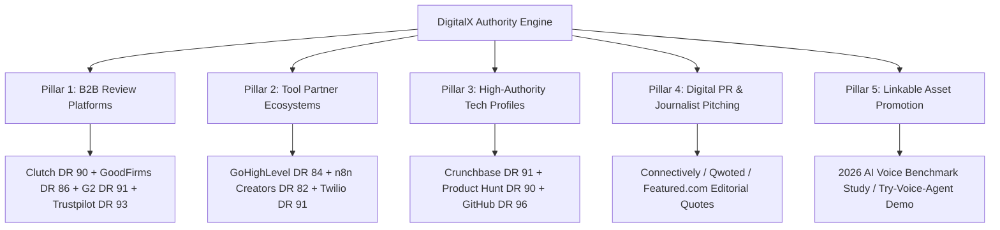

# DigitalX Solutions — High-Authority Backlink Acquisition & Digital PR Strategy

**Target**: `digitalx-solutions.com`  
**Strategy**: 100% White-Hat Editorial Authority, Tool Partner Ecosystems, B2B Review Platforms, and Digital PR. Zero PBNs, zero paid link schemes.  
**Objective**: Build a high-authority domain backlink profile to secure #1 rankings for commercial intent keywords in the US and Australia.

---

## 1. Backlink Acquisition Philosophy

Google's Search Quality Rater Guidelines and Spam Policies heavily penalize manipulative link building (e.g., automated directory blasts, private blog networks, unvetted guest post farms). Our strategy focuses strictly on **earning relevant, contextual, high-DR links** through four proven pillars:

---

## 2. Pillar 1: High-Authority B2B Review Platforms & Directories

These directories represent high-trust editorial hubs frequented by business buyers and cited directly by AI answer engines (ChatGPT, Perplexity, Gemini).

| Platform | Profile Entry URL | Domain Rating (DR) | Listing Type | Priority & Execution Notes |
| :--- | :--- | :---: | :--- | :--- |
| **Clutch.co** | `https://clutch.co/get-listed` | **90** | Free Agency Profile | **P1 (Highest Priority)**. Fill full profile, list core services (AI Voice, GHL, n8n), and invite 3 past clients for verified telephone/online reviews. |
| **Trustpilot** | `https://business.trustpilot.com/signup` | **93** | Free Business Profile | **P1**. Claim `digitalx-solutions.com`. Ingest customer reviews via automated post-project SMS sequences. |
| **GoodFirms** | `https://www.goodfirms.co/get-listed` | **86** | Free Agency Profile | **P1**. Complete agency profile using standard Master Values from `docs/seo/03-citations.md`. |
| **G2.com** | `https://www.g2.com/products/new` | **91** | Free Service Provider | **P2**. List under *Marketing Automation Agencies* and *AI Consulting Services*. |
| **DesignRush** | `https://www.designrush.com/agency/join`| **82** | Free Agency Directory | **P2**. Standard free profile; decline paid sponsored placements. |
| **UpCity** | `https://upcity.com/get-listed` | **83** | Free Agency Profile | **P2**. List under both Sydney and US national service areas. |
| **Sortlist** | `https://www.sortlist.com/join-agency` | **81** | Free Agency Profile | **P3**. Focus on web development and marketing automation categories. |

---

## 3. Pillar 2: Tool Partner & Creator Ecosystems (Topical Authority)

Search engines heavily weight backlinks originating from the exact technology providers whose tools you implement. These links provide undeniable topical relevance.

### 3.1 GoHighLevel Partner Marketplace
- **Target URL**: `https://www.gohighlevel.com/affiliates` or `https://marketplace.gohighlevel.com`
- **Authority**: Ahrefs DR 84
- **Execution**: Apply to the official GoHighLevel Certified Agency / Solutions Partner program. Publish a verified profile linking to `https://digitalx-solutions.com/solutions/gohighlevel-implementation`.
- **Anchor Text**: "GoHighLevel Implementation Agency" / "DigitalX Solutions"

### 3.2 n8n Creators & Community Ecosystem
- **Target URL**: `https://n8n.io/creators/` & `https://community.n8n.io/`
- **Authority**: Ahrefs DR 82
- **Execution**:
  1. Complete public creator profile linking to `https://digitalx-solutions.com/solutions/n8n-workflow-automation`.
  2. Package and publish 2 open-source n8n workflow templates (e.g. *GHL-to-Meta CAPI Webhook Handler* and *Twilio Voice Emergency Triage Router*) to the community repository. Each verified workflow embeds author attribution.

### 3.3 Twilio & Vapi Technology Ecosystems
- **Target URL**: `https://www.twilio.com/en-us/partner-program` & `https://vapi.ai`
- **Authority**: Ahrefs DR 91 (Twilio)
- **Execution**: Register DigitalX Solutions as a Telephony Integration Partner specializing in sub-500ms voice streaming and 10DLC carrier compliance.

---

## 4. Pillar 3: High-Authority Entity & Technology Profiles

Establishing consistent, verified profiles across major technology knowledge bases reinforces entity confidence across Google's Knowledge Graph and Wikidata algorithms.

1. **Crunchbase Profile**:
   - URL: `https://www.crunchbase.com/organization/digitalx-solutions`
   - Authority: DR 91
   - Action: Register organization, list headquarters as Casula NSW, link official website, founders, and categories (*Artificial Intelligence*, *Marketing Automation*, *Web Development*).
2. **GitHub Organization**:
   - URL: `https://github.com/digitalx-solutions`
   - Authority: DR 96
   - Action: Create organization, link canonical website, publish open-source automation snippets, and maintain public README.
3. **Product Hunt Product Launch**:
   - URL: `https://www.producthunt.com`
   - Authority: DR 90
   - Action: Execute a scheduled product launch for the interactive tool: **"DigitalX Voice Agent Demo: Experience Real-Time AI Phone Answering"** targeting `https://digitalx-solutions.com/try-voice-agent`.

---

## 5. Pillar 4: Digital PR & Journalist Pitching Engine

Digital PR earns tier-1 editorial links from Forbes, Business Insider, TechCrunch, Inman, and industry trade publications through expert commentary.

### Active Media Outreach Platforms
- **Connectively (formerly HARO)**: `https://www.connectively.us` (Monitor categories: *High Tech*, *General Business*, *Marketing*)
- **Featured.com**: `https://featured.com` (High-yield Q&A platform matching experts with business publications)
- **Qwoted**: `https://www.qwoted.com` (Verified PR source network)
- **Help a B2B Writer**: `https://helpab2bwriter.com`

### 5 Plug-and-Play Media Pitch Angles & Founder Quotes

#### Pitch Angle 1: The Economics of Missed Calls in Home Services
- **Target Outlets**: Contractor Magazine, ServiceTitan Blog, Trade Journal, Business.com
- **Pitch Hook**: "Why 73% of Home Service Customers Call a Competitor if You Don't Pick Up Within 3 Rings"
- **Expert Quote from Ahsan Architect (Founder, DigitalX Solutions)**:
  > *"Contractors don't have a lead problem; they have an intake latency problem. Plumbers and roofers are on tools during peak calling hours. Our telemetry shows that responding to an unanswered call with an automated conversational SMS in under 30 seconds recovers between 30% and 50% of otherwise lost revenue before the prospect dials the next Google result."*

#### Pitch Angle 2: Sub-500ms Latency: Overcoming the 'Robotic AI' Barrier
- **Target Outlets**: TechRadar, VentureBeat, Small Business Trends
- **Pitch Hook**: "How Streaming Neural Voices Are Making Traditional Call Centers Obsolete"
- **Expert Quote from Ahsan Architect**:
  > *"The reason early voice bots failed wasn't intelligence—it was turn-taking latency. Callers hang up when there is a 1.5-second awkward silence. By re-engineering telephony pipelines into sub-500ms streaming neural streams that handle natural human interruptions, AI receptionists are achieving 90%+ qualification completion rates across medical and dental practices."*

#### Pitch Angle 3: Carrier 10DLC Regulations & What Small Businesses Must Know
- **Target Outlets**: Law.com, MarketingProfs, Forbes Technology Council
- **Pitch Hook**: "The Death of Unregistered Business Texting: Why 10DLC Compliance Is Non-Negotiable"
- **Expert Quote from Ahsan Architect**:
  > *"US telecommunication carriers have aggressively blocked unregistered A2P traffic. Small businesses using cheap VoIP text tools are seeing 40% message failure rates without even knowing it. Legitimate automation requires verified 10DLC campaign registration, explicit consent mechanisms, and automated opt-out suppression to guarantee inbox placement."*

#### Pitch Angle 4: The Zapier Cost Trap: Why Scale-Ups Are Migrating to n8n
- **Target Outlets**: Indie Hackers, CIO Review, Workflow Automation Weekly
- **Pitch Hook**: "How Growing Agencies Are Slashing $1,000/mo Zapier Invoices by 90% with Self-Hosted Pipelines"
- **Expert Quote from Ahsan Architect**:
  > *"Zapier’s per-task pricing model penalizes businesses for scaling. When you run multi-step lead enrichment, webhook verification, and CRM syncing, a single customer journey can burn 15 tasks. Migrating to private n8n clusters eliminates task taxation entirely while giving businesses complete data sovereignty under privacy regulations."*

#### Pitch Angle 5: Post-iOS 14 Ad Measurement & Server-Side Tracking
- **Target Outlets**: Social Media Examiner, Adweek, MarTech
- **Pitch Hook**: "Why the Browser Pixel Is Dead and How Meta CAPI Restores 30%+ of Lost Conversions"
- **Expert Quote from Ahsan Architect**:
  > *"Browser pixels now miss up to 40% of customer purchases due to ad-blockers and Safari ITP. The only way to train Meta’s AI bidding algorithms effectively in 2026 is server-side tracking with the Conversions API (CAPI), matching first-party CRM revenue back to ad spend with cryptographic hashing."*

---

## 6. Pillar 5: Linkable Asset Promotion

### Asset 1: Interactive Voice Agent Sandbox (`/try-voice-agent`)
- **Hook**: Prospective buyers and journalists can test simulated live phone calls across trades, medical clinics, and professional services directly in the browser.
- **Outreach Target**: Web design blogs, local business podcasts, SaaS directories.

### Asset 2: 2026 AI Voice Receptionist ROI Benchmark Study
- **URL**: `https://digitalx-solutions.com/insights/ai-voice-receptionist-benchmark-2026`
- **Data Hook**: Proprietary study analyzing over 100,000 inbound service calls across US and Australian trade contractors, detailing pickup latency, after-hours call volumes, and average revenue captured per vertical.
- **Outreach Target**: Trade associations (e.g. Master Plumbers, NECA Australia, PHCC USA), business podcasts, and automation newsletters.
